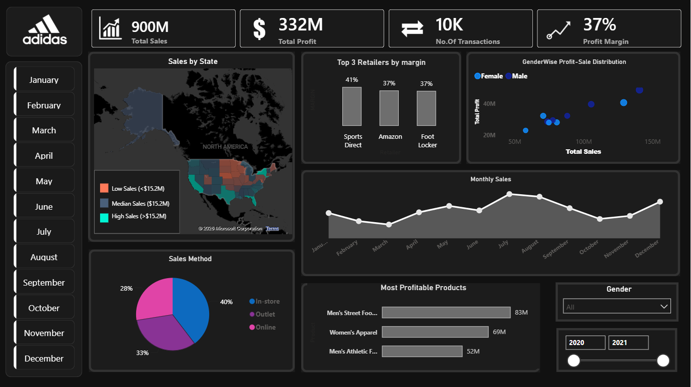

# Adidas US Sales Dashboard | Power BI

An interactive Power BI dashboard analysing sample Adidas US sales data from 2020–2021. The project explores revenue, profitability, retailer performance, product categories, sales channels, gender distribution, geographic sales patterns, and seasonality to identify potential business opportunities.

### Dashboard Preview



### Business Questions

- Which retailers generate the highest sales and profit margins?
- Which product categories contribute most to sales and operating profit?
- Which states contribute most to overall sales?
- How does performance differ across sales channels and between men's and women's products?
- How do sales trends change throughout the year?

### Key Metrics

| Metric | Value |
| :--- | ---: |
| **Total Sales** | $900M |
| **Total Profit** | $332M |
| **No. of Transactions** | ~10K |
| **Profit Margin** | 37% |

*Figures are rounded. The dataset has no order ID, so each row is treated as one transaction record.*

---

### Key Insights

#### 1. Retailer Performance

West Gear leads total sales at $243M, while Sports Direct records the highest profit margin at 41%, compared with 37% for Amazon and Foot Locker. High sales volume and high profit margin are not the same thing.

#### 2. Geographic Sales Distribution

The state map is shaded by total sales (teal = higher, brown = lower).

- **High-sales markets:** California, Texas, Florida, and New York fall in the high-sales tier, above the $15.2M state-sales threshold.
- **Mid-tier markets:** Washington, Oregon, Illinois, Georgia, and North Carolina sit around the middle of the state-level distribution.
- **Lower-sales markets:** Several central and inland states, including Montana, Wyoming, North Dakota, South Dakota, Nebraska, Iowa, and Kansas, fall below the threshold.

*Population, retail presence, distribution, and brand awareness could explain these differences, but the sales data alone does not establish their effects. The $15.2M threshold is used to segment state sales performance; it is not a measure of market potential or profitability.*

#### 3. Gender Distribution

Men's products generate $486M in sales (54%) and women's products $414M (46%), a fairly balanced mix with a modest lead for men's products.

#### 4. Sales Channel Mix

Outlet accounts for 33% and Online for 28% of sales, approximately 61% combined, compared with 40% from In-store, the largest single channel.

*Percentages may not total exactly 100% because of rounding.*

#### 5. Product Performance

Men's Street Footwear leads the highlighted categories in both sales ($209M) and operating profit ($83M), followed by Women's Apparel ($179M sales; $69M profit) and Men's Athletic Footwear ($154M sales; $52M profit). Men's Street Footwear also has the highest operating margin of the three, at approximately 39.7%.

#### 6. Seasonality

Sales peak around July–August and December, with dips around March and October.

---

### Business Recommendations

- **Prioritise margin alongside volume:** Sports Direct earns a 41% margin versus 37% for Amazon and Foot Locker. Evaluate retailer partnerships and promotional spending using both margin and sales volume, and investigate why high-volume West Gear earns less per dollar of sales.
- **Plan inventory and campaigns around seasonality:** Use the observed July–August and December peaks to inform planning, and investigate the March and October dips for potential promotional opportunities. Validate these patterns against more recent data.
- **Focus on leading product categories:** Men's Street Footwear and Women's Apparel perform strongly in both sales and operating profit. Evaluate their margins and performance trends to inform inventory and promotional decisions. Investigate women's category growth and profitability before identifying expansion opportunities.
- **Evaluate channel and geographic opportunities:** Outlet and Online contribute approximately 61% of sales. Assess their profitability alongside In-store performance before reallocating resources. Investigate the factors behind state-level sales differences before making market expansion decisions.

*These recommendations are based on historical sample data and represent areas for further investigation, not confirmed business outcomes.*

---

### Data Modelling and Methodology

#### Calendar Table

A separate calendar table was created in Power Query using `List.Dates` to generate a continuous date range. It supports time-based analysis and allows the year filter to work consistently across the dashboard.

#### DAX Measures

Key performance indicators were calculated using DAX functions including `SUM`, `COUNTROWS`, and `DIVIDE`.

```dax
Total Sales = SUM('Data Sales Adidas'[TOTAL SALE])

Total Profit = SUM('Data Sales Adidas'[Operating Profit])

No.Of Transactions = COUNTROWS('Data Sales Adidas')

Profit Margin = DIVIDE([Total Profit], [Total Sales])
```

*Note: The transaction measure counts rows because the dataset does not contain an order ID. It therefore represents transaction records rather than independently verified unique orders.*

---

### Tools Used

- **Microsoft Excel:** Working with the dataset
- **Power BI Desktop:** Dashboard development, visualisation, and geographic analysis
- **Power Query (M):** Calendar table creation using `List.Dates`
- **DAX:** KPI calculations and profitability analysis

---

### Repository Contents

- `Adidas_Dashboard.pbix` — Interactive Power BI report (open with Power BI Desktop).
- `Addidas_Dashboard.png` — Dashboard screenshot preview.

---

### Data Scope and Limitations

- Uses sample Adidas US sales data covering 2020–2021.
- Findings reflect the supplied dataset, not Adidas's actual company-wide performance.
- Geographic differences do not by themselves establish differences in market potential, demand, or profitability.
- The analysis identifies historical patterns but does not establish causation.
- Recommendations require validation against more recent data and additional business context.

### Author

**Prisha Kamra**
